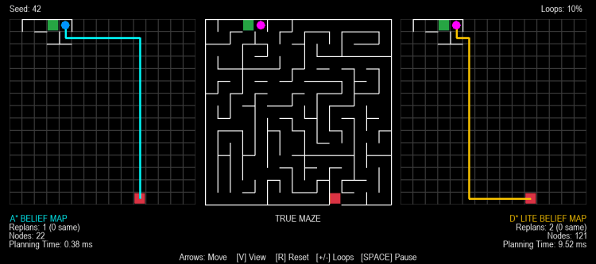
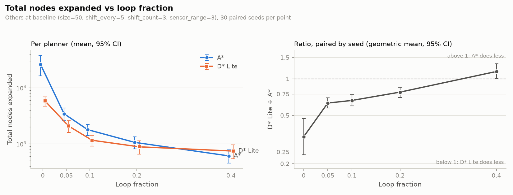

# Kessel Run

A robot with limited sensing navigates a labyrinth whose walls shift over time, comparing A* (replan from scratch) against D* Lite (incremental replanning).



## How it works

- **Maze:** recursive-backtracker generation with adjustable loops; one exit placed at the farthest border cell from the start
- **Shifting walls:** each shift opens a closed wall, then closes a random wall on the loop that creates, so every cell stays reachable.
- **Robot:** line-of-sight sensing up to a fixed range; plans on its own belief map, treating unknown walls as open
- **Planners:** A* replans from scratch only when a wall closes on its path or a wall it believed closed opens; D* Lite repairs its existing plan instead
- **Seeded and reproducible:** both planners face the identical maze and shift sequence

## Results

30 seeds per configuration (1,380 runs, all reached the exit), both planners on the same maze and shift sequence.
Baseline: 50×50, 10% loops, 3 walls swapped every 5 ticks, sensor range 3.

At baseline, D* Lite expanded **34% fewer nodes** than A* over a full run, with
similar path lengths (D* Lite ~2% shorter on average). In wall-clock time it was **~5–6× slower per tick**:
each D* Lite expansion does more bookkeeping, so fewer nodes doesn't mean less time.
Even with no loops, where it expands a third as many nodes, it is still ~3× slower.



- **Loops decide the winner:** with no loops, D* Lite expands 67% fewer nodes; at 40% loops, A* expands 15% fewer
- **D* Lite's lead grows with maze size:** 26% fewer nodes at 25×25, 45% fewer at 100×100
- **Shift size barely matters:** D* Lite stays 32–38% ahead from 1 to 32 walls per shift


## Running it

```bash
pip install -r requirements.txt
python main.py              # race viewer
python benchmark.py         # run experiments -> results/benchmark.csv
python analyze.py --metric nodes_expanded   # generate plots
python main.py --size 15 --record docs/race.gif     # get gif of race
python -m pytest            # run tests
```

Controls: `R` new maze · `+/-` loops · `Space` pause